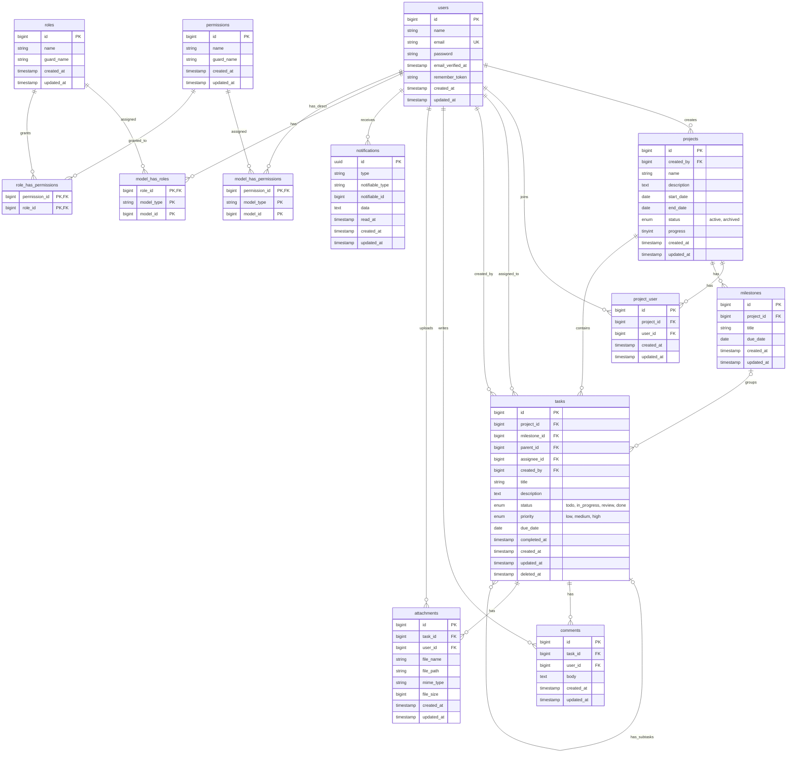

# Dokumen Perancangan — Aplikasi Manajemen Tugas (Task Management App)

## Daftar Isi

- **Bagian I — PRD (Product Requirements Document)**
- **Bagian II — ERD dan Desain Database**
  - ERD
  - A. Tabel Aplikasi (`users` sampai `notifications`)
  - B. Tabel Role & Permission (spatie/laravel-permission v8)
  - C. Ringkasan Relasi
  - D. Rancangan Role & Permission
  - E. Langkah Implementasi
  - F. Catatan Aturan Bisnis

---

## Bagian I — PRD (Product Requirements Document)

|              |                                                |
|--------------|------------------------------------------------|
| Nama Sistem  | Aplikasi Manajemen Tugas (Task Management App) |
| Tanggal      | *15 Oktober 2026*                              |
| Disusun oleh | *Achmad Dito*                                  |
| Instansi     | *UPN “VETERAN” Jogja*                          |

### **1. Ringkasan Singkat**

*Task Management App adalah aplikasi online terpusat untuk mengelola tugas dan proyek secara kolaboratif. Anggota tim dapat membuat, menugaskan, mengunggah lampiran, dan melacak progress tugas secara real-time, sementara manajer memantau workload dan laporan produktivitas. Target dari sistem ini adalah mengurangi miss deadline dan menggantikan proses manual via chat atau spreadsheet menjadi sistem yang efisien, transparan, dan terintegrasi.*

### **2. Siapa Saja yang Akan Memakai Sistem**

*Cukup sebutkan peran-peran orang yang akan login, dan apa yang boleh mereka lakukan.*

| **Peran**       | **Contoh Orangnya**            | **Bisa Ngapain Saja**                                                                                                    |
|-----------------|--------------------------------|--------------------------------------------------------------------------------------------------------------------------|
| Admin           | Staf TI / Project Owner        | Atur semua data proyek, hak akses pengguna, dan konfigurasi sistem.                                                      |
| Project Manager | Manajer Proyek / Team Lead     | Buat & assign task, kelola proyek, pantau beban kerja, dan lihat laporan tim.                                        |
| Team Member     | Anggota Tim / Staf / Karyawan  | Buat tugas baru, update status task milik sendiri, unggah attachment/file, buat sub-task, dan berdiskusi lewat komentar. |
| Viewer / Klien  | Stakeholder / Klien / Pimpinan | Lihat progress proyek task secara read-only, analisis laporan produktivitas, serta memberikan catatan/komentar.          |

### **3. Layanan yang Ingin Dibuat Sistemnya**

*Untuk tiap layanan (misalnya pelatihan, sewa ruangan, sertifikasi), jawab 3 pertanyaan ini saja. Salin blok di bawah untuk tiap layanan tambahan.*

#### **Layanan A — Manajemen Tugas (Task Management)**

**a) Apa langkah-langkahnya, dari task dibuat sampai selesai?**

1.  User membuat task baru dengan mengisi judul, deskripsi, prioritas, dan tenggat waktu (deadline).

2.  Task ditugaskan (assign) kepada anggota tim terkait atau diri sendiri.

3.  Assignee memperbarui status task secara bertahap: To Do → In Progress → Review → Done.

4.  Pengguna menambahkan komentar, attachment (lampiran file), dan sub-task jika diperlukan.

5.  Sistem secara otomatis mengirimkan notifikasi dan reminder mendekati deadline.

6.  Task ditandai selesai (Done) dan otomatis masuk ke dalam rekap laporan progress.

**b) Data apa saja yang perlu disimpan sistem?**

- *Judul task, deskripsi, assignee, created by, status, prioritas, due date (deadline), proyek terikat, riwayat komentar, attachment (file lampiran), sub-task, dan timestamps (tanggal dibuat diperbarui).*

**c) Ada aturan khusus yang harus dipatuhi sistem?**

- *"Hanya assignee atau Project Manager yang bisa mengubah status task."*

- *"Tenggat waktu (deadline) tidak boleh di masa lalu saat dibuat; task yang melewati deadline otomatis ditandai merah (overdue)."*

- *"Task yang sudah berstatus Done tidak dapat diubah kembali kecuali oleh Admin atau Project Manager."*

#### **Layanan B — Manajemen Proyek (Project Workspace)**

**a) Langkah-langkahnya:**

- *1. Project Manager membuat ruang proyek baru (nama proyek, deskripsi, tanggal mulai selesai, serta mengundang anggota tim).*

- *2. Menambahkan dan mengelompokkan task ke dalam proyek atau milestone tertentu.*

- *3. Tim memantau progress keseluruhan proyek secara terpusat (menggunakan tampilan Kanban board atau daftar).*

- *4. Project Manager mengarsip (archive) proyek setelah seluruh rangkaian tugas selesai.*

**b) Data yang disimpan:**

- *Nama proyek, deskripsi, tanggal mulai (start date), tanggal selesai (end date), daftar anggota (members), daftar task terkait, persentase progress (%), dan status proyek (active/archived).*

**c) Aturan khusus:**

- *"Hanya Project Manager dan Admin yang dapat membuat, mengubah, atau mengarsip proyek." "Persentase progress proyek dihitung secara otomatis berdasarkan rasio task yang berstatus Done." "Hanya anggota yang terdaftar di dalam proyek tersebut yang dapat melihat dan mengelola task di dalamnya."*

### **4. Laporan & Dashboard yang Dibutuhkan**

*Dashboard = ringkasan angka yang muncul begitu login. Laporan = dokumen yang dicetak/diunduh berkala.*

| **Ingin lihat apa?**    | **Contoh**                                                                                                                |
|-------------------------|---------------------------------------------------------------------------------------------------------------------------|
| Info di dashboard utama | Total task open, task overdue, daftar my tasks, persentase progress per proyek, dan grafik workload per member.           |
| Laporan rutin           | Laporan progress mingguan/bulanan (format PDF/Excel), statistik produktivitas tim, dan task completion rate per triwulan. |

### **5. Catatan untuk AI Coding Assistant**

*Bagian ini boleh dibiarkan seperti apa adanya — ini instruksi teknis otomatis untuk AI, bukan sesuatu yang perlu Anda tulis ulang.*

- Tiap Layanan di Bagian 3 → jadi satu modul/menu di sistem

- Tiap langkah alur → jadi status transaksi/alur kerja (contoh: To Do → In Progress → Review → Done).

- Tiap data yang dicatat → jadi tabel dan kolom di database.

- Tiap aturan bisnis → jadi validasi otomatis pada level aplikasi/sistem.

- Bagian 4 → jadi tampilan dashboard interaktif + fungsi ekspor laporan ke format PDF/Excel.

---

## Bagian II — ERD dan Desain Database

Dokumen ini menjabarkan desain database berdasarkan PRD, mengikuti konvensi Laravel: nama tabel jamak berbahasa Inggris dalam `snake_case`, primary key `id`, foreign key `{singular}_id`, serta kolom `created_at` dan `updated_at`.

Manajemen role dan permission memakai paket [spatie/laravel-permission v8](https://spatie.be/docs/laravel-permission/v8/basic-usage/basic-usage). Kolom `users.role` pada versi sebelumnya **dihapus** dan digantikan oleh lima tabel bawaan Spatie (bagian 9–13).

Semua kolom `id` bertipe `bigint unsigned` auto-increment, kecuali `notifications` yang memakai UUID.

### ERD



---

### A. Tabel Aplikasi

#### 1. `users`

Menyimpan akun pengguna. Peran tidak lagi disimpan di tabel ini, melainkan lewat trait `HasRoles` dan tabel `model_has_roles`.

| Kolom | Tipe | Keterangan |
|---|---|---|
| id | bigint unsigned | Primary key |
| name | varchar(255) | Nama lengkap |
| email | varchar(255) | Unique |
| email_verified_at | timestamp | Nullable |
| password | varchar(255) | Hash bcrypt |
| remember_token | varchar(100) | Nullable |
| created_at, updated_at | timestamp | Nullable (standar Laravel) |

#### 2. `projects`

Ruang kerja proyek (Layanan B).

| Kolom | Tipe | Keterangan |
|---|---|---|
| id | bigint unsigned | Primary key |
| created_by | bigint unsigned | FK ke `users.id`, pembuat proyek (PM atau Admin) |
| name | varchar(255) | Nama proyek |
| description | text | Nullable |
| start_date | date | Tanggal mulai |
| end_date | date | Nullable, tanggal selesai |
| status | enum | `active`, `archived`. Default `active` |
| progress | tinyint unsigned | 0–100, dihitung otomatis dari rasio task `done`. Default 0 |
| created_at, updated_at | timestamp | |

#### 3. `project_user` (pivot)

Anggota yang terdaftar di sebuah proyek.

| Kolom | Tipe | Keterangan |
|---|---|---|
| id | bigint unsigned | Primary key |
| project_id | bigint unsigned | FK ke `projects.id`, cascade on delete |
| user_id | bigint unsigned | FK ke `users.id`, cascade on delete |
| created_at, updated_at | timestamp | |

Unique index gabungan `(project_id, user_id)` agar anggota tidak terdaftar ganda.

#### 4. `milestones`

Pengelompokan task dalam proyek.

| Kolom | Tipe | Keterangan |
|---|---|---|
| id | bigint unsigned | Primary key |
| project_id | bigint unsigned | FK ke `projects.id`, cascade on delete |
| title | varchar(255) | Nama milestone |
| due_date | date | Nullable |
| created_at, updated_at | timestamp | |

#### 5. `tasks`

Tabel inti (Layanan A), termasuk sub-task.

| Kolom | Tipe | Keterangan |
|---|---|---|
| id | bigint unsigned | Primary key |
| project_id | bigint unsigned | FK ke `projects.id`, cascade on delete |
| milestone_id | bigint unsigned | Nullable, FK ke `milestones.id`, null on delete |
| parent_id | bigint unsigned | Nullable, FK ke `tasks.id` (self-reference). Terisi berarti sub-task |
| assignee_id | bigint unsigned | Nullable, FK ke `users.id`, penerima tugas |
| created_by | bigint unsigned | FK ke `users.id`, pembuat task |
| title | varchar(255) | Judul task |
| description | text | Nullable |
| status | enum | `todo`, `in_progress`, `review`, `done`. Default `todo` |
| priority | enum | `low`, `medium`, `high`. Default `medium` |
| due_date | date | Tenggat waktu |
| completed_at | timestamp | Nullable, diisi saat status menjadi `done` |
| created_at, updated_at | timestamp | |
| deleted_at | timestamp | Nullable (SoftDeletes) |

Index yang disarankan: `(project_id, status)`, `assignee_id`, dan `due_date`, untuk dashboard serta pencarian task overdue.

#### 6. `comments`

Diskusi pada task.

| Kolom | Tipe | Keterangan |
|---|---|---|
| id | bigint unsigned | Primary key |
| task_id | bigint unsigned | FK ke `tasks.id`, cascade on delete |
| user_id | bigint unsigned | FK ke `users.id`, penulis komentar (termasuk Viewer) |
| body | text | Isi komentar |
| created_at, updated_at | timestamp | |

#### 7. `attachments`

Lampiran file pada task.

| Kolom | Tipe | Keterangan |
|---|---|---|
| id | bigint unsigned | Primary key |
| task_id | bigint unsigned | FK ke `tasks.id`, cascade on delete |
| user_id | bigint unsigned | FK ke `users.id`, pengunggah |
| file_name | varchar(255) | Nama asli file |
| file_path | varchar(255) | Lokasi di storage |
| mime_type | varchar(100) | Tipe file |
| file_size | bigint unsigned | Ukuran dalam byte |
| created_at, updated_at | timestamp | |

#### 8. `notifications`

Struktur bawaan Laravel untuk notifikasi dan reminder deadline (`php artisan notifications:table`).

| Kolom | Tipe | Keterangan |
|---|---|---|
| id | uuid | Primary key |
| type | varchar(255) | Nama class notifikasi |
| notifiable_type | varchar(255) | Polymorphic, biasanya `App\Models\User` |
| notifiable_id | bigint unsigned | Polymorphic, ID penerima |
| data | text | JSON isi notifikasi (misalnya `task_id`, pesan) |
| read_at | timestamp | Nullable, null berarti belum dibaca |
| created_at, updated_at | timestamp | |

---

### B. Tabel Role & Permission (spatie/laravel-permission v8)

Kelima tabel ini dibuat otomatis oleh migration bawaan paket (`create_permission_tables`). Nama tabel dan kolom di bawah adalah default dari `config/permission.php`, jadi **tidak perlu dibuat manual**.

#### 9. `roles`

Kelompok permission yang diberikan ke pengguna.

| Kolom | Tipe | Keterangan |
|---|---|---|
| id | bigint unsigned | Primary key |
| name | varchar(255) | Nama role: `admin`, `project_manager`, `team_member`, `viewer` |
| guard_name | varchar(255) | Default `web` |
| created_at, updated_at | timestamp | |

Unique index gabungan `(name, guard_name)`.

#### 10. `permissions`

Kemampuan spesifik yang diperiksa aplikasi (misalnya `create projects`).

| Kolom | Tipe | Keterangan |
|---|---|---|
| id | bigint unsigned | Primary key |
| name | varchar(255) | Nama permission, mis. `edit tasks` |
| guard_name | varchar(255) | Default `web` |
| created_at, updated_at | timestamp | |

Unique index gabungan `(name, guard_name)`.

#### 11. `model_has_roles` (pivot polymorphic)

Role yang dimiliki sebuah model (dalam aplikasi ini: `User`).

| Kolom | Tipe | Keterangan |
|---|---|---|
| role_id | bigint unsigned | FK ke `roles.id`, cascade on delete |
| model_type | varchar(255) | Class model, mis. `App\Models\User` |
| model_id | bigint unsigned | ID model (user) |

Primary key gabungan `(role_id, model_id, model_type)`, serta index `(model_id, model_type)`.

#### 12. `model_has_permissions` (pivot polymorphic)

Permission yang diberikan **langsung** ke model, tanpa lewat role.

| Kolom | Tipe | Keterangan |
|---|---|---|
| permission_id | bigint unsigned | FK ke `permissions.id`, cascade on delete |
| model_type | varchar(255) | Class model, mis. `App\Models\User` |
| model_id | bigint unsigned | ID model (user) |

Primary key gabungan `(permission_id, model_id, model_type)`, serta index `(model_id, model_type)`.

Menurut panduan Spatie, pengguna **sebaiknya jarang** diberi permission langsung. Dalam aplikasi ini tabel tersebut praktis dibiarkan kosong.

#### 13. `role_has_permissions` (pivot)

Permission yang dimiliki sebuah role.

| Kolom | Tipe | Keterangan |
|---|---|---|
| permission_id | bigint unsigned | FK ke `permissions.id`, cascade on delete |
| role_id | bigint unsigned | FK ke `roles.id`, cascade on delete |

Primary key gabungan `(permission_id, role_id)`.

---

### C. Ringkasan Relasi

| Relasi | Jenis |
|---|---|
| `users` → `projects` (created_by) | One to many |
| `projects` ↔ `users` via `project_user` | Many to many |
| `projects` → `milestones` | One to many |
| `projects` → `tasks` | One to many |
| `milestones` → `tasks` | One to many (opsional) |
| `tasks` → `tasks` (parent_id) | One to many (sub-task) |
| `users` → `tasks` (assignee_id, created_by) | One to many, dua kali |
| `tasks` → `comments`, `attachments` | One to many |
| `users` → `comments`, `attachments`, `notifications` | One to many |
| `users` ↔ `roles` via `model_has_roles` | Many to many (polymorphic) |
| `roles` ↔ `permissions` via `role_has_permissions` | Many to many |
| `users` ↔ `permissions` via `model_has_permissions` | Many to many (polymorphic, jarang dipakai) |

---

### D. Rancangan Role & Permission

Prinsip dari dokumentasi Spatie ("Roles vs Permissions"):

- **Users memiliki roles**, **roles memiliki permissions**.
- Aplikasi memeriksa **permission**, bukan nama role. Gunakan `can()`, `@can`, Policy, dan middleware `permission:`.
- Nama permission dibuat granular, mis. `view tasks` dan `edit tasks` dipisah.

#### Daftar permission

| Grup | Permission |
|---|---|
| Pengguna | `manage users`, `manage roles` |
| Proyek | `view projects`, `create projects`, `edit projects`, `archive projects`, `manage project members` |
| Task | `view tasks`, `create tasks`, `assign tasks`, `edit tasks`, `delete tasks`, `update task status`, `reopen tasks`, `manage all tasks` |
| Komentar | `create comments`, `delete comments` |
| Lampiran | `upload attachments`, `delete attachments` |
| Dashboard & laporan | `view dashboard`, `view reports`, `export reports` |

#### Matriks role dan permission

Tanda ✓ berarti permission diberikan ke role. Tanda ◐ berarti permission diberikan, tetapi dibatasi lagi oleh Policy (misalnya hanya untuk task milik sendiri atau proyek yang diikuti).

| Permission | admin | project_manager | team_member | viewer |
|---|:---:|:---:|:---:|:---:|
| `manage users` | ✓ | | | |
| `manage roles` | ✓ | | | |
| `view projects` | ✓ | ✓ | ◐ | ◐ |
| `create projects` | ✓ | ✓ | | |
| `edit projects` | ✓ | ✓ | | |
| `archive projects` | ✓ | ✓ | | |
| `manage project members` | ✓ | ✓ | | |
| `view tasks` | ✓ | ✓ | ◐ | ◐ |
| `create tasks` | ✓ | ✓ | ◐ | |
| `assign tasks` | ✓ | ✓ | | |
| `edit tasks` | ✓ | ✓ | ◐ | |
| `delete tasks` | ✓ | ✓ | | |
| `update task status` | ✓ | ✓ | ◐ | |
| `reopen tasks` | ✓ | ✓ | | |
| `manage all tasks` | ✓ | ✓ | | |
| `create comments` | ✓ | ✓ | ✓ | ✓ |
| `delete comments` | ✓ | ✓ | | |
| `upload attachments` | ✓ | ✓ | ✓ | |
| `delete attachments` | ✓ | ✓ | ◐ | |
| `view dashboard` | ✓ | ✓ | ✓ | ✓ |
| `view reports` | ✓ | ✓ | | ✓ |
| `export reports` | ✓ | ✓ | | |

Catatan:

- `team_member` yang membuat task boleh menugaskan ke dirinya sendiri (PRD: "ditugaskan kepada anggota tim terkait atau diri sendiri"). Hal ini dicek di `TaskPolicy` atau Form Request, sedangkan `assign tasks` untuk menugaskan ke orang lain.
- `reopen tasks` dipakai untuk aturan "task `done` tidak dapat diubah kecuali oleh Admin atau Project Manager".
- `manage all tasks` memungkinkan PM mengubah task yang bukan miliknya.

---

### E. Langkah Implementasi

#### 1. Instalasi

```bash
composer require spatie/laravel-permission
php artisan vendor:publish --provider="Spatie\Permission\PermissionServiceProvider"
php artisan optimize:clear
php artisan migrate
```

Catatan dari dokumentasi:

- Jika sudah ada file `config/permission.php`, ganti namanya atau hapus terlebih dahulu.
- Pada MySQL 8+ yang menampilkan `ERROR 1071 Specified key was too long`, batasi panjang kolom `name` dan `guard_name` di migration (lihat halaman Prerequisites).
- Jika memakai `CACHE_STORE=database`, pasang juga migration cache Laravel.

#### 2. Tambahkan trait pada model `User`

```php
use Illuminate\Foundation\Auth\User as Authenticatable;
use Spatie\Permission\Traits\HasRoles;

class User extends Authenticatable
{
    use HasRoles;

    // ...
}
```

#### 3. Seeder role dan permission

```php
use Illuminate\Database\Seeder;
use Spatie\Permission\Models\Permission;
use Spatie\Permission\Models\Role;
use Spatie\Permission\PermissionRegistrar;

class RolePermissionSeeder extends Seeder
{
    public function run(): void
    {
        app(PermissionRegistrar::class)->forgetCachedPermissions();

        $permissions = [
            'manage users', 'manage roles',
            'view projects', 'create projects', 'edit projects',
            'archive projects', 'manage project members',
            'view tasks', 'create tasks', 'assign tasks', 'edit tasks',
            'delete tasks', 'update task status', 'reopen tasks', 'manage all tasks',
            'create comments', 'delete comments',
            'upload attachments', 'delete attachments',
            'view dashboard', 'view reports', 'export reports',
        ];

        foreach ($permissions as $name) {
            Permission::firstOrCreate(['name' => $name]);
        }

        Role::firstOrCreate(['name' => 'admin'])
            ->syncPermissions(Permission::all());

        Role::firstOrCreate(['name' => 'project_manager'])->syncPermissions([
            'view projects', 'create projects', 'edit projects',
            'archive projects', 'manage project members',
            'view tasks', 'create tasks', 'assign tasks', 'edit tasks',
            'delete tasks', 'update task status', 'reopen tasks', 'manage all tasks',
            'create comments', 'delete comments',
            'upload attachments', 'delete attachments',
            'view dashboard', 'view reports', 'export reports',
        ]);

        Role::firstOrCreate(['name' => 'team_member'])->syncPermissions([
            'view projects',
            'view tasks', 'create tasks', 'edit tasks', 'update task status',
            'create comments',
            'upload attachments', 'delete attachments',
            'view dashboard',
        ]);

        Role::firstOrCreate(['name' => 'viewer'])->syncPermissions([
            'view projects', 'view tasks',
            'create comments',
            'view dashboard', 'view reports',
        ]);
    }
}
```

#### 4. Memberi role ke pengguna

```php
$user->assignRole('team_member');      // saat registrasi (default)
$user->syncRoles(['project_manager']); // mengganti role
$user->getRoleNames();                 // collection nama role
$user->getAllPermissions();            // semua permission (via role)

User::role('project_manager')->get();            // daftar semua PM
User::permission('view reports')->get();         // semua user yang boleh melihat laporan
```

#### 5. Admin sebagai Super-Admin (opsional, sesuai halaman "Defining a Super-Admin")

Agar Admin otomatis lolos semua pemeriksaan `can()` dan Policy, termasuk keanggotaan proyek, daftarkan `Gate::before` di `AppServiceProvider::boot()`:

```php
use Illuminate\Support\Facades\Gate;

Gate::before(function ($user, $ability) {
    return $user->hasRole('admin') ? true : null;
});
```

#### 6. Middleware pada route

Daftarkan alias di `bootstrap/app.php`:

```php
use Spatie\Permission\Middleware\PermissionMiddleware;
use Spatie\Permission\Middleware\RoleMiddleware;
use Spatie\Permission\Middleware\RoleOrPermissionMiddleware;

->withMiddleware(function (Middleware $middleware) {
    $middleware->alias([
        'role' => RoleMiddleware::class,
        'permission' => PermissionMiddleware::class,
        'role_or_permission' => RoleOrPermissionMiddleware::class,
    ]);
})
```

Contoh pemakaian (tanda `|` berarti OR). Middleware bawaan Laravel `can:` juga bisa dipakai untuk satu permission:

```php
Route::middleware(['auth', 'permission:create projects'])
    ->post('/projects', [ProjectController::class, 'store']);

Route::middleware(['auth', 'permission:view reports|export reports'])
    ->get('/reports', [ReportController::class, 'index']);

Route::middleware(['auth', 'can:manage users'])
    ->resource('/users', UserController::class);
```

#### 7. Policy untuk aturan kepemilikan dan keanggotaan proyek

Permission menjawab "role ini boleh melakukan apa", sedangkan Policy menjawab "pada data yang mana". Contoh `TaskPolicy` untuk aturan PRD:

```php
class TaskPolicy
{
    private function isMember(User $user, Task $task): bool
    {
        return $task->project->members()->whereKey($user->id)->exists();
    }

    public function view(User $user, Task $task): bool
    {
        return $user->can('view tasks') && $this->isMember($user, $task);
    }

    public function updateStatus(User $user, Task $task): bool
    {
        if (! $this->isMember($user, $task) || ! $user->can('update task status')) {
            return false;
        }

        // Task done hanya bisa diubah oleh yang punya permission reopen tasks
        if ($task->status === 'done') {
            return $user->can('reopen tasks');
        }

        // Hanya assignee atau PM (manage all tasks)
        return $task->assignee_id === $user->id || $user->can('manage all tasks');
    }

    public function update(User $user, Task $task): bool
    {
        return $this->isMember($user, $task)
            && $user->can('edit tasks')
            && ($task->created_by === $user->id
                || $task->assignee_id === $user->id
                || $user->can('manage all tasks'));
    }
}
```

Relasi `members()` pada model `Project`:

```php
public function members()
{
    return $this->belongsToMany(User::class); // memakai tabel project_user
}
```

#### 8. Pemakaian di controller dan Blade

```php
$this->authorize('updateStatus', $task);
```

```blade
@can('create projects')
    <a href="{{ route('projects.create') }}">Buat proyek</a>
@endcan

@can('updateStatus', $task)
    {{-- dropdown status task --}}
@endcan
```

#### 9. Opsi lanjutan: role per proyek (Teams)

Saat ini role bersifat **global** (satu pengguna satu peran di seluruh aplikasi), sesuai PRD. Jika nanti dibutuhkan seorang pengguna menjadi PM di proyek A tetapi Team Member di proyek B, Spatie menyediakan fitur Teams: set `'teams' => true` di `config/permission.php` (dan opsional `team_foreign_key`, misalnya `project_id`) **sebelum** menjalankan migration. Fitur ini menambah kolom team pada `roles`, `model_has_roles`, dan `model_has_permissions`, sehingga sebaiknya diputuskan sejak awal.

---

### F. Catatan Aturan Bisnis

Aturan berikut dari PRD diterapkan di level aplikasi (Policy, Form Request, Observer):

- **Ubah status task:** hanya assignee atau Project Manager. Setelah `done`, hanya yang memiliki permission `reopen tasks` (Admin dan Project Manager). Lihat `TaskPolicy::updateStatus`.
- **Deadline:** `due_date` tidak boleh di masa lalu saat task dibuat (Form Request `after_or_equal:today`). Status overdue tidak disimpan, melainkan dihitung dari `due_date < today AND status != done` (accessor atau query scope `overdue()`).
- **Progress proyek:** `projects.progress` dihitung dari rasio task `done` terhadap total task, diperbarui lewat Observer pada model `Task`.
- **Akses proyek:** hanya anggota di `project_user` yang dapat melihat dan mengelola task dalam proyek tersebut (dicek di Policy, dikecualikan untuk Admin lewat `Gate::before`).
- **Pembuatan, perubahan, dan pengarsipan proyek:** dibatasi permission `create projects`, `edit projects`, `archive projects` (Admin dan Project Manager).
- **Laporan PDF/Excel:** dihasilkan dari query ke tabel di atas, dibatasi permission `view reports` dan `export reports`.
